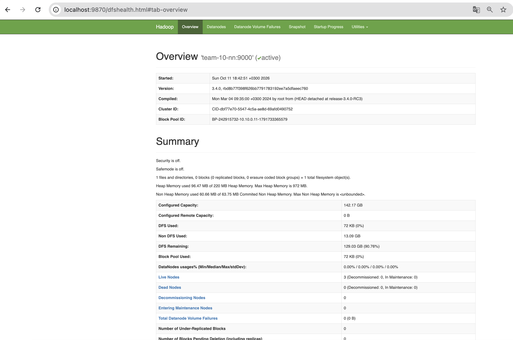
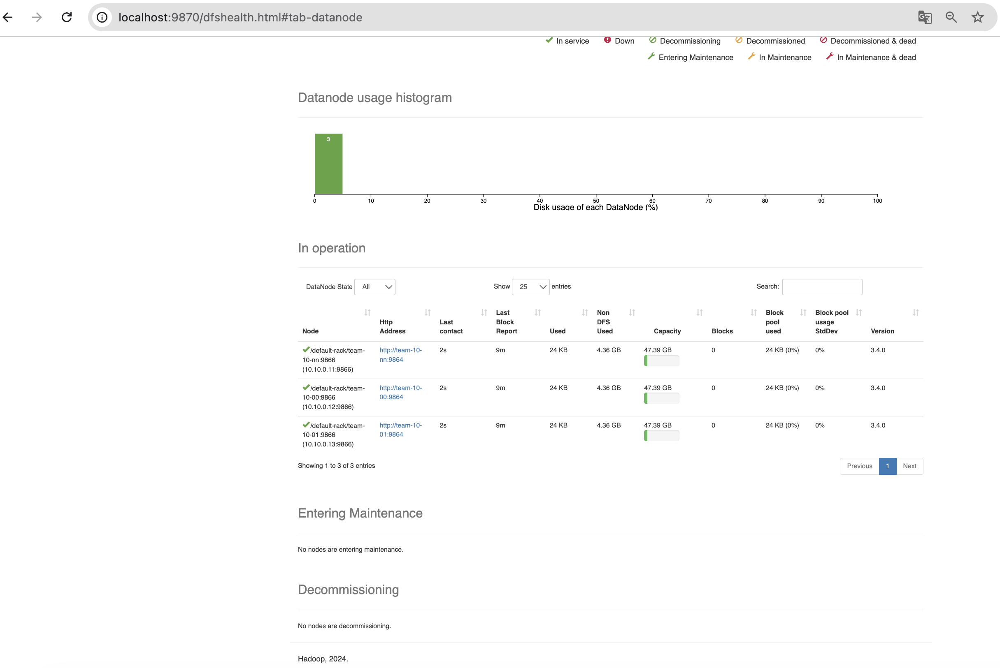

# Развертывание кластера HDFS

Скрипт `script.sh` разворачивает кластер HDFS на четырех узлах team-10. В кластере работают NameNode, Secondary NameNode и три DataNode.

Используется Hadoop 3.4.0, Java 11 и Ubuntu 24.04.

## Схема кластера

| Узел | Адрес | Что запущено |
|---|---|---|
| team-10-en | 10.10.0.10 | edge, отсюда запускается скрипт |
| team-10-nn | 10.10.0.11 | NameNode, Secondary NameNode, DataNode |
| team-10-00 | 10.10.0.12 | DataNode |
| team-10-01 | 10.10.0.13 | DataNode |

(третью DataNode ставим на team-10-nn, т.к отдельных узлов под данные два)

## Запуск

Скрипт запускается на edge от пользователя `team` и ходит на узлы по ключу `~/.ssh/team_internal`

Копируем скрипт на edge:

```bash
scp script.sh team@2.59.81.13:~/
```

Далее заходим на edge и открываем tmux (чтобы скрипт не оборвался, если пропадет связь):

```bash
ssh team@2.59.81.13
tmux new -s hadoop
```

Запускаем скрипт

```bash
bash script.sh
```

Скрипт работает от 15 до 40 минут, и больше всего времени уходит на скачивание Hadoop на каждый узел. Если появится окно с вопросом о перезапуске служб, то просто нажимаем Enter.

При первом подключении к каждому узлу ssh спросит `Are you sure you want to continue connecting`, тогда на это надо ответить `yes`.

Если же связь всё-таки оборвалась, тогда заходим на edge и возвращаемся в сессию командой `tmux attach -t hadoop`.

## Что делает скрипт

1. Обновляет пакеты и ставит Java 11 на edge
2. Создает ssh-ключ на namenode и раздает его на все узлы
3. На каждом узле комментирует строку `127.0.1.1` в `/etc/hosts`, ставит Java и скачивает Hadoop в `/home/team/hadoop-3.4.0`
4. Прописывает `HADOOP_HOME`, `JAVA_HOME` и `PATH` в `~/.profile` на каждом узле
5. Готовит на edge конфиги `hadoop-env.sh`, `core-site.xml`, `hdfs-site.xml` и `workers` и копирует их на узлы
6. Форматирует NameNode (если он ещё не отформатирован)
7. Запускает кластер командой `start-dfs.sh` и показывает `jps` на каждом узле

## Настройки кластера

В `core-site.xml` указан адрес NameNode `hdfs://team-10-nn:9000`

В `hdfs-site.xml` задан фактор репликации 3 и адрес Secondary NameNode `team-10-nn:9868`. Данные хранятся в `/home/team/hdfs-data` в папках `namenode`, `datanode` и `checkpoint`

В `workers` перечислены узлы с DataNode. Это team-10-nn, team-10-00 и team-10-01

## Проверка

### jps

В конце скрипт сам выводит `jps` для каждого узла. На team-10-nn должны быть NameNode, SecondaryNameNode и DataNode, на team-10-00 и team-10-01 по одной DataNode (номера процессов будут другими).

```
103598 NameNode
103951 SecondaryNameNode
103741 DataNode
102810 DataNode
103249 DataNode
```

### Отчет NameNode

Выполняем на edge:

```bash
ssh -i ~/.ssh/team_internal team@team-10-nn "source ~/.profile && hdfs dfsadmin -report | grep -E 'Live datanodes|Name:'"
```

Должны быть три живые DataNode:

```
Live datanodes (3):
Name: 10.10.0.11:9866 (team-10-nn)
Name: 10.10.0.12:9866 (team-10-00)
Name: 10.10.0.13:9866 (team-10-01)
```

### Веб-интерфейс NameNode

На своем компьютере открываем туннель через edge:

```bash
ssh -N -L 9870:team-10-nn:9870 team@2.59.81.13
```

Пока окно с туннелем открыто, интерфейс работает по адресу http://localhost:9870. Туннель закрывается через Ctrl+C, а кластер при этом продолжает работать.

На странице Overview должно быть `Live Nodes 3` и `Dead Nodes 0`:



На вкладке Datanodes все три узла в состоянии In service:



## Повторный запуск и перезагрузка

Скрипт можно запускать повторно. Скачанный ранее Hadoop он пропустит, также NameNode второй раз не отформатирует, и переменные в `~/.profile` не продублирует.

После перезагрузки серверов файлы остаются на месте, но кластер нужно будет запустить заново:

```bash
ssh -i ~/.ssh/team_internal team@team-10-nn "source ~/.profile && start-dfs.sh"
```

Остановить кластер можно командой `stop-dfs.sh`.